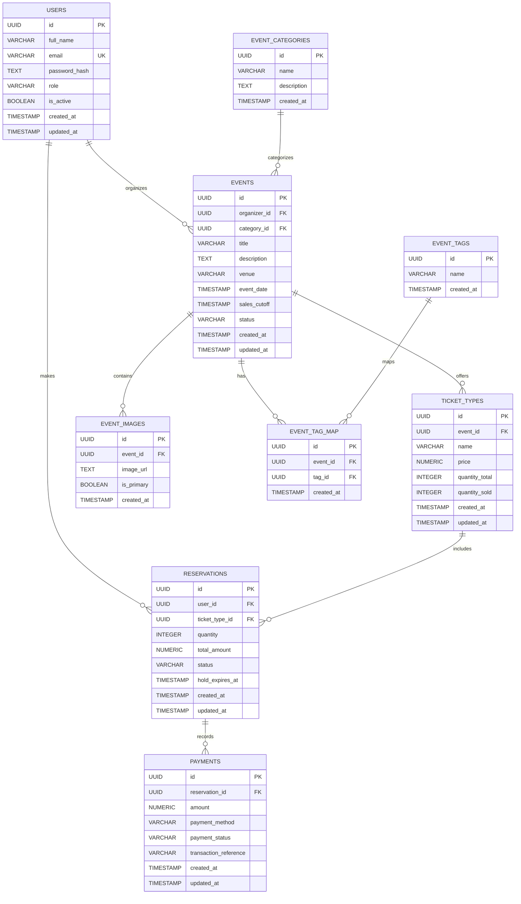
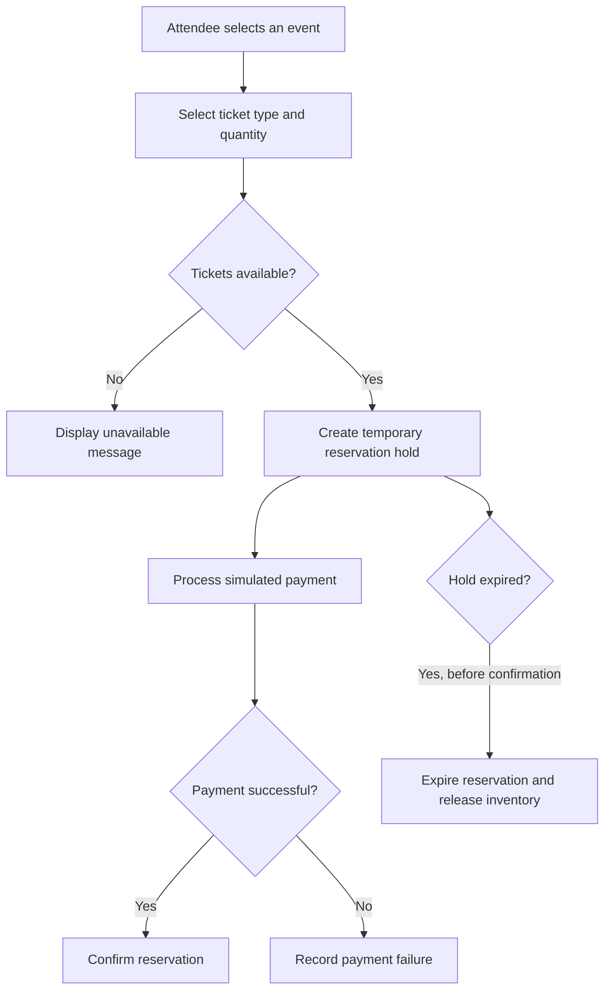

# EventEase — Multi-Tenant Event & Ticket Reservation System

**Live Website:** [https://eventease-multi-tenant-event-ticket-reservation-s.ai.studio](https://eventease-multi-tenant-event-ticket-reservation-s.ai.studio)

## 1. Project Overview

EventEase is a web-based event management and ticket reservation system designed to support multiple user roles. It aims to simplify event creation, ticket inventory management, reservations, payment processing, and booking analytics.

The platform is designed around three roles:

- **Admin:** Manages users, events, and platform activities.
- **Organizer:** Creates and manages events and ticket types.
- **Attendee:** Browses events, reserves tickets, and views bookings.

## 2. Key Features

- Role-based access control (RBAC).
- Event creation, updating, publishing, and cancellation.
- Ticket type and price management.
- Ticket availability and inventory tracking.
- Temporary ticket reservation holds.
- Payment simulation and transaction status tracking.
- Booking history.
- Event and reservation analytics.
- API testing for expired reservations, concurrent bookings, and duplicate requests.

*Note: Verify these features against the deployed application before describing them as fully implemented.*

## 3. Technology Stack

The exact stack should be confirmed from the generated application source code.

| Component      | Technology       |
| -------------- | ---------------- |
| Frontend       | To be verified   |
| Backend        | To be verified   |
| Database       | To be verified   |
| Authentication | To be verified   |
| Deployment     | Google AI Studio |

## 4. Entity Relationship Diagram (ERD)

The following ERD represents the proposed database model for EventEase. It should be checked against the actual database schema before being treated as the final implementation diagram.

### ERD Entity Descriptions

| Entity             | Description                                                                        |
| ------------------ | ---------------------------------------------------------------------------------- |
| `USERS`            | Stores account details, email, role, and account status.                           |
| `EVENTS`           | Stores event details, schedule, venue, status, and organizer reference.            |
| `TICKET_TYPES`     | Stores ticket categories, prices, and inventory for events.                        |
| `RESERVATIONS`     | Records attendees' ticket reservations, quantities, amounts, and expiration times. |
| `PAYMENTS`         | Stores payment attempts, amounts, statuses, and transaction references.            |
| `EVENT_IMAGES`     | Stores image URLs associated with events.                                          |
| `EVENT_CATEGORIES` | Organizes events into categories such as music, technology, and workshops.         |
| `EVENT_TAGS`       | Stores tags used to classify and discover events.                                  |
| `EVENT_TAG_MAP`    | Connects events and tags through a many-to-many relationship.                      |

**Key notation:**

- **PK:** Primary Key
- **FK:** Foreign Key
- **UK:** Unique Key

### Database Relationships

1. One user can organize multiple events.
2. One user can make multiple reservations.
3. One event can offer multiple ticket types.
4. One ticket type can appear in multiple reservations.
5. One reservation can have multiple payment records.
6. One event can contain multiple images.
7. One event category can contain multiple events.
8. Events can have multiple tags, and each tag can be associated with multiple events.

## 5. Ticket Reservation Workflow

## 6. Reservation Engine

The reservation engine is designed to manage ticket availability and temporary booking holds.

### Intended Process

1. The attendee selects a ticket type and quantity.
2. The system checks available inventory.
3. A temporary reservation hold is created.
4. The attendee completes the payment process.
5. A successful payment confirms the reservation.
6. An expired or cancelled hold releases the reserved inventory.

### Reliability Considerations

- Database transactions or row-level locking should protect inventory updates.
- Concurrent booking requests must not oversell tickets.
- Reservation expiration must be enforced by the backend.
- Payment confirmation should be idempotent to prevent duplicate processing.

## 7. API Testing and Postman Collection

A Postman collection should be created using the actual API routes from the application source code.

### Recommended Test Cases

| Test Case                                     | Expected Result                               |
| --------------------------------------------- | --------------------------------------------- |
| Register with valid details                   | Account created if registration is supported  |
| Register with an existing email               | Duplicate account rejected                    |
| Login with invalid credentials                | Authentication rejected                       |
| Access protected route without authentication | Request rejected                              |
| Organizer accesses an admin-only route        | Access denied                                 |
| Create event with invalid data                | Validation error returned                     |
| Reserve more tickets than available           | Reservation rejected                          |
| Reservation hold expires                      | Reservation expires and inventory is released |
| Two users request the last ticket             | Inventory remains consistent                  |
| Repeat payment confirmation                   | No duplicate successful payment               |
| Attendee accesses booking history             | Only authorized bookings returned             |

### Suggested Postman Collection Structure

1. Authentication
2. User and role management
3. Event management
4. Ticket type and inventory management
5. Reservation creation and expiration
6. Payment simulation
7. Booking history and analytics
8. Negative and concurrency testing

**Deliverable:** Export the tested collection to `postman/EventEase.postman_collection.json` after confirming the real endpoints.

## 8. Security Considerations

- Store password hashes instead of plaintext passwords.
- Enforce role-based permissions on the backend.
- Validate and sanitize user input.
- Use parameterized SQL queries or a secure ORM.
- Protect inventory updates with transactions or row-level locks.
- Keep credentials and API secrets in environment variables.
- Avoid exposing sensitive user and payment information.
- Configure production CORS and authentication correctly.

## 9. Future Enhancements

- QR-code ticket generation and event check-in.
- Email confirmations and event reminders.
- Refund and cancellation workflows.
- Organizer sales reports and revenue analytics.
- Event search, filtering, and pagination.
- Audit logging and API rate limiting.

## Conclusion

EventEase is designed to provide a centralized platform for event management and ticket reservations. Its proposed data model covers users, events, ticket types, reservations, payments, categories, images, and tags.

The system's key engineering goals include secure role-based access, reliable ticket inventory, temporary reservation holds, payment-state management, and protection against overselling. The final documentation should be updated to match the application's verified implementation.
